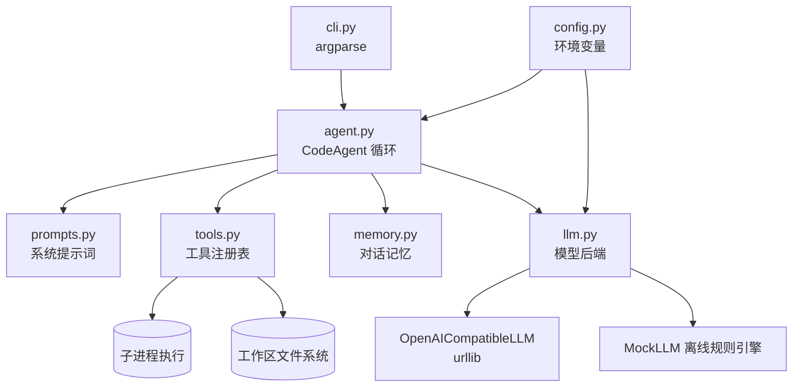
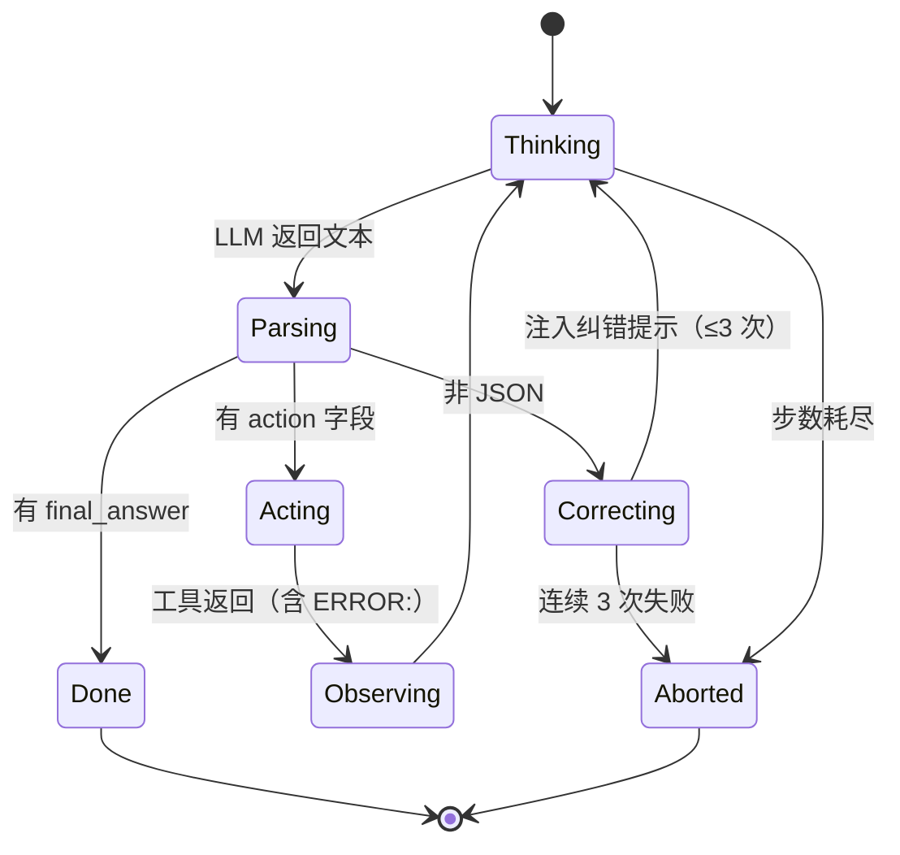

# CodePilot 设计文档

> Homework 1 · Code Agent · 2412190233 郑俊豪

本文说明 CodePilot 的**架构决策**与**取舍理由**，而不是重复 README 里的使用说明。
重点回答三个问题：为什么这样分层？循环为什么长这样？要新增能力时改哪里？

---

## 1. 目标与非目标

**目标**

1. 一个真实可用的代码审查 Agent：能看到完整文件、能取证、能给出可执行的修复建议。
2. 一个**能被复用的组件**：Next homework 的 Workflow 需要把它当成节点调用，所以必须是
   "返回结构化结果"的函数，而不是"打印一堆字的脚本"。
3. 在没有网络、没有 Key 的环境里也能演示和测试——评审老师很可能直接 `python main.py ...`。

**非目标**

- 不做多语言（只审查 Python，换取更准的行号与规则）；
- 不做向量检索 / 代码索引（单文件审查 + 正则取证已够用）；
- 不做生产级沙箱（见"已知限制"）。

这三个"不做"是刻意砍的：**MVP 的完成度比功能数量更重要**，多做的每个功能都会拖低代码质量得分。

---

## 2. 总体架构



**分层原则：依赖只向下**

| 层 | 允许依赖 | 职责 |
|----|----------|------|
| `cli` | 全部 | 参数解析、输出格式、退出码 |
| `agent` | llm / tools / memory / prompts | 编排循环、解析模型输出、错误降级 |
| `tools` | 标准库 | 执行副作用并返回字符串观察 |
| `llm` | config / 标准库 | 提供 `complete(messages) -> str` |
| `memory` | 标准库 | 有界历史 |
| `config` | 标准库 | 不可变配置 |

好处很直接：`agent` 不知道 HTTP 存在，`tools` 不知道模型存在，
所以测试时可以只替换一层（`ScriptedLLM` 替换模型、临时目录替换文件系统），
55 个测试跑完只要 0.2 秒。

---

## 3. Agent 循环设计

### 3.1 状态机



### 3.2 为什么用"单 JSON 动作"而不是 ReAct 文本格式

教科书 ReAct 用 `Thought:/Action:/Observation:` 的纯文本格式。这里改成 **JSON 对象**，原因：

1. **可校验**。文本格式下"Action 后面跟了什么"全靠正则猜；JSON 可以严格解析并给出纠错。
2. **可参数化**。工具参数是结构化对象（`{"path": ..., "max_lines": ...}`），
   不需要再发明一套参数语法。
3. **可测试**。`ScriptedLLM` 直接喂 JSON 字符串即可覆盖全部分支。

代价是模型偶尔会输出非法 JSON —— 这正好被"纠错重试"兜住，而且实测（离线规则引擎）零成本。

### 3.3 关键常量与取舍

| 决策 | 取值 | 理由 |
|------|------|------|
| 每轮工具调用数 | 1 | 并行调用会让"观察"顺序不确定，MVVM 调试困难 |
| 最大步数 | 8（可配） | 审查典型需要 3~5 步；8 步足够且能兜住打转 |
| JSON 纠错次数 | 3 | 1 次太严格（模型常常只差个转义），>3 次是浪费 token |
| 工具输出上限 | 12000 字符 | 防止一次 `read_file` 撑爆上下文 |
| 重试退避 | `backoff^attempt` | 简单、无依赖；生产可换成 jitter + 熔断 |

### 3.4 输出解析器

`extract_json_object()` 是循环里最容易出 bug 的地方，单独实现并单独测试：

1. 去掉首尾 ``` 围栏（模型很爱加）；
2. 从第一个 `{` 开始**按括号深度**扫描，同时跟踪字符串状态与转义，直到深度归零；
3. 对候选串 `json.loads`，失败就从下一个 `{` 重试。

这样能正确处理 `{"thought": "用 {braces} 表示"}` 这种字符串内花括号，也能跳过
"Sure! Here is my review: {...}" 这种前置寒暄。`tests/test_agent.py::ExtractJsonTest`
用 7 个用例把这套逻辑钉死。

---

## 4. 工具层设计

### 4.1 为什么工具返回字符串而不是异常

Agent 循环里，**工具失败也是一种信息**：模型看到 `ERROR: path is outside the workspace`
之后会自己换路径。如果工具直接抛异常，要么整个流程崩掉，要么需要写一堆 `try/except` 包裹。
统一在 `ToolRegistry.run()` 里把任何异常转成 `ERROR:` 前缀的字符串，循环体因此保持线性，
模型也有了自愈的机会（`test_unknown_tool_is_reported_to_the_model` 验证了这一点）。

### 4.2 路径沙箱

```python
resolved = (workspace / raw).resolve()
if resolved != root and root not in resolved.parents:
    raise ToolError("outside the workspace")
```

先 `resolve()` 再判断，可以同时挡住 `../..` 和符号链接逃逸；判断用 `parents` 而不是
字符串前缀，避免 `/work` 与 `/work-evil` 这类前缀误判。

### 4.3 代码执行的边界

`run_python` 会真的起子进程，所以：

- 只允许在工作区内读写（临时文件放在 `.codeagent_tmp/`，执行完删除）；
- `subprocess.run(timeout=...)` 硬超时，防止 `while True` 卡死 Agent；
- `CODEAGENT_ALLOW_EXEC=0` 可整体关闭（CI、只读评审环境）；
- 明确声明**这不是安全沙箱**，只是"防手滑"，避免夸大安全性。

---

## 5. 记忆设计

问题：多轮对话迟早超出上下文窗口。三种常见方案的取舍：

| 方案 | 优点 | 缺点 | 采用 |
|------|------|------|------|
| 全量保留 | 信息无损 | 必然超窗、成本线性增长 | ✗ |
| 滑窗截断 | 简单 | 丢掉早期结论，模型会"失忆" | ✗ |
| 滑窗 + 摘要 | 兼顾成本与连续性 | 摘要本身有损 | ✓ |
| 向量召回 | 长期记忆强 | 引入依赖与复杂度，MVP 不需要 | ✗ |

实现要点：以**完整问答对**为单位淘汰（`del turns[:2]`），保证不会出现
"孤儿 assistant 消息"——部分严格服务商（如 Claude、部分国产 API）会因消息角色不交替而报错。
摘要有 1200 字符上限，防止摘要本身无限膨胀。

---

## 6. 错误处理矩阵

| 层 | 失败模式 | 策略 | 用户可见行为 |
|----|----------|------|--------------|
| 配置 | 缺 Key | 自动回落离线模型 | 正常出报告 |
| 模型 | 401/429/5xx/超时 | 指数退避重试 3 次 | 重试日志（`-v`） |
| 模型 | 输出非 JSON | 纠错提示，3 次后终止 | 明确的失败原因 |
| 工具 | 参数错/路径错/正则错 | `ERROR:` 观察 | 模型自行纠正 |
| 工具 | 子进程超时 | `ERROR: timed out` | 同上 |
| 循环 | 步数耗尽 | 汇总已有证据 | 降级报告而非异常 |
| CLI | 文件不存在/越界 | 退出码 2 + 提示 | 不打印 traceback |

---

## 7. 扩展指南

### 新增一个工具（例如 `git_blame`）

1. 在 `tools.py` 写 `def tool_git_blame(args, ctx) -> str`，用 `_resolve()` 校验路径；
2. 在 `build_default_registry()` 里 `registry.register(Tool(...))`；
3. 完成。系统提示词由 `build_system_prompt(registry)` **自动生成**，模型立刻知道新工具存在。

这是刻意设计：工具文档与实现同源（single source of truth），新增工具不需要改两处。

### 换成另一种 Agent 策略（Plan-and-Execute）

`CodeAgent.run()` 只依赖 `BaseLLM.complete(messages) -> str` 与 `ToolRegistry.run()`，
把循环换成"先出计划、再逐步执行"只需替换 `run()` 的内部实现，工具层完全不动。

### 被 HW2 编排

`CodeAgent.review()` 返回 `AgentResult`（含 `final_answer`、`steps`、`stopped_reason`、`elapsed`），
HW2 的 `ReviewAgent` 节点直接读这个对象，不需要解析终端输出。见
`hw2-workflow/workflow/adapters/hw1_reviewer.py`。

---

## 8. 测试策略

| 层次 | 手段 | 例子 |
|------|------|------|
| 纯函数 | 直接断言 | `extract_json_object` 7 例 |
| 工具 | 临时工作区 + 真实文件 | 路径逃逸、非法正则 |
| 循环 | 注入 `ScriptedLLM` 脚本 | 脏 JSON、缺参、步数上限 |
| 重试 | 自定义会抛错的假模型 | 1 次失败后成功 |
| 回归 | 离线规则引擎 + 真实样例 | `buggy_calculator.py` 命中 10 条 |

没有引入 pytest / mock 库，全部用 `unittest` + 手写替身，**测试本身零依赖**，
评审方 clone 下来就能跑。

---

## 9. 与评分标准的对应

| 维度 | 权重 | 本项目对应实现 |
|------|------|----------------|
| 功能完整性 | 40% | 完整循环、5 个工具、CLI + 交互模式、记忆、重试、降级，均有测试 |
| Agent 架构 | 30% | 分层依赖、工具注册表、可替换模型后端、结构化结果 |
| 代码质量 | 20% | 全量类型注解、docstring、55 个测试、无第三方依赖 |
| 文档 | 10% | README（用法）+ Design（决策）+ 代码内注释解释"为什么" |
