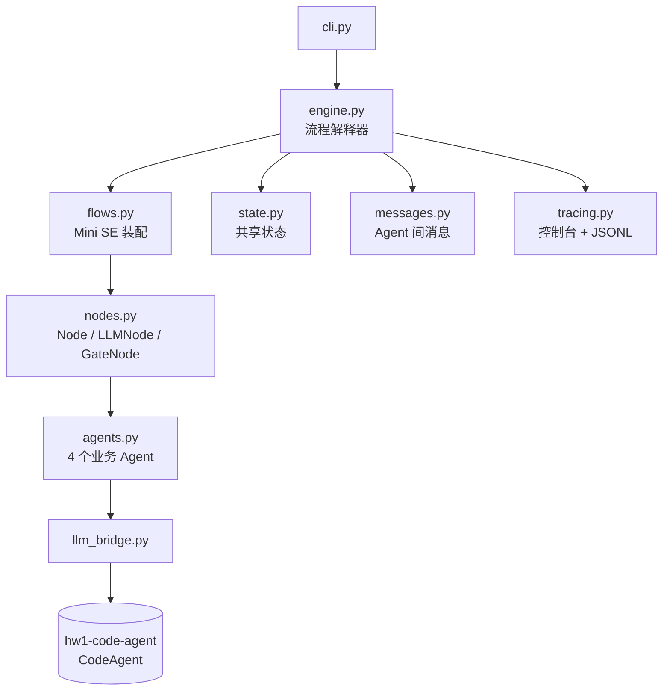
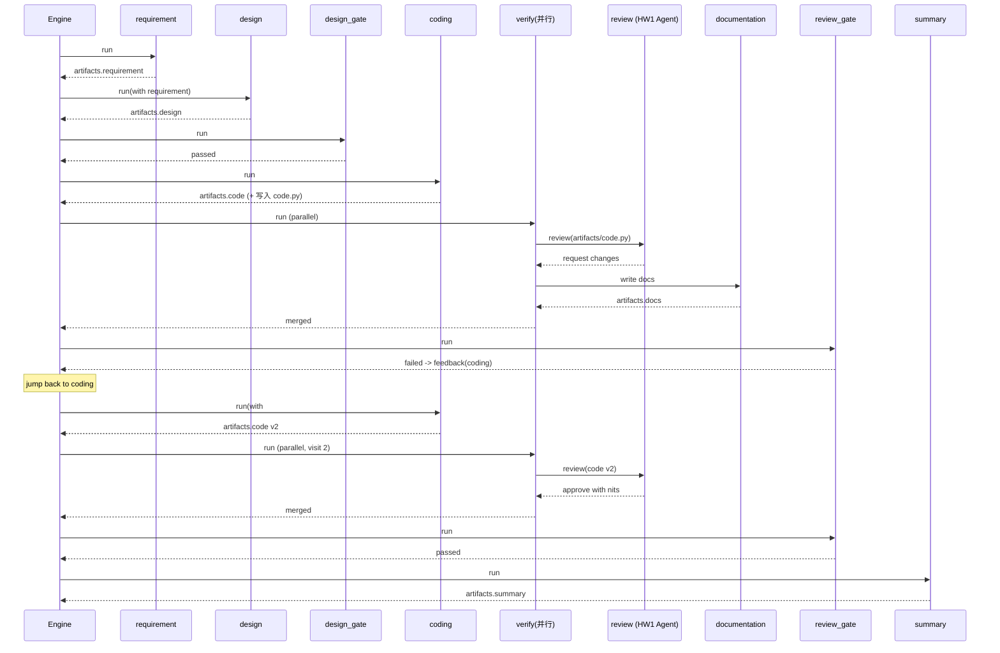

# Mini SE Workflow 设计文档

> Homework 2 · Simple Workflow MVP · 2412190233 郑俊豪

本文记录**为什么这样编排**：状态为什么是单一写入者、控制流为什么用「属性」而不是图引擎、
质量门为什么做结构化校验、并行放在哪一步。目标读者是两周后要在这个骨架上加 Agent 的人。

---

## 1. 目标与约束

| 约束 | 影响 |
|------|------|
| 2 周 MVP | 不引入 LangGraph / CrewAI / Dify，自己写 ~600 行可解释的引擎 |
| 必须复用项目 1 的 Agent | HW1 必须以**库**而不是脚本的形式被调用 |
| MVP 也要能演示 | 离线模型让 4 种控制结构在无网络、无 Key 时也能真实走到 |
| 评审方要看懂 | 每一步都有日志、每条消息都可见、每次跳转都有原因 |

**非目标**：任务队列、持久化、多租户、可视化编辑器。这些会把两周耗在基础设施上，而不是流程本身。

---

## 2. 架构



依赖方向单一：`cli → engine → flows → nodes/agents → bridge`，`state/messages/tracing` 是被动的数据与
基础设施模块，不反向依赖任何业务逻辑。因此：

- 换掉 CLI 不影响引擎；
- 换掉模型不影响流程定义；
- 单独测试引擎时不需要真实 Agent。

---

## 3. 数据模型

### 3.1 WorkflowState

```python
@dataclass
class WorkflowState:
    task: str                       # 用户任务
    run_id: str                     # 一次运行的 ID（也是产物目录名）
    artifacts: Dict[str, str]       # requirement / design / code / review / ...
    messages: List[AgentMessage]    # Agent 间通信记录
    errors: List[str]               # 失败与护栏原因
    visits: Dict[str, int]          # 每个步骤被执行的次数
    status: str                     # running / completed / failed
```

**为什么产物用 `dict[str, str]` 而不是自定义类**：每个 Agent 的产出形态不同（Markdown 文档、代码、
结论字符串），统一成文本后，网关、汇总、落盘、状态快照都只需要一种处理方式；需要结构化时
（例如 `review_verdict`）再单独放一个短字符串字段，而不是嵌套对象。

### 3.2 AgentMessage

```python
AgentMessage(sender, recipient, kind, content, payload, ts)
```

`kind` 只有五种（`handoff / result / feedback / error / system`），并且**校验非法值**。
限制枚举是为了让日志可读：看到 `[feedback]` 就知道这是退改，而不是一句含糊的"消息"。

**关键设计**：`feedback` 消息会被下游 Agent 真正消费——`CodingNode.build_prompt()` 把
发给自己的 feedback 拼进提示词。如果消息只是记录而没人读，那它就只是日志。

---

## 4. 控制流语义

引擎就是一个 `while index < len(steps)` 的循环，四个属性定义全部行为：

| 属性 | 位置 | 语义 |
|------|------|------|
| `when(state)` | Step | 返回 False 则跳过该步（条件分支） |
| `on_fail` | Step | 步骤失败时跳到指定步骤（回退循环） |
| `max_visits` | Step | 允许执行的最大次数（循环护栏） |
| `retries` | Step | 节点抛异常时的重试次数（错误恢复） |
| `ParallelStep.nodes` | 步骤 | 并发执行，结果按声明顺序合并 |

### 4.1 执行伪代码

```text
index = 0
while index < len(steps):
    if 全局步数超限: 失败退出
    step = steps[index]
    if step.when and not step.when(state): index += 1; continue
    visit = state.visit(step.label)
    if visit > step.max_visits: 失败退出（loop guard）
    result = 执行(step, state)            # 含 retries
    合并 result 的产物与消息到 state
    if result.failed:
        if step.on_fail: index = 位置(step.on_fail); continue
        else: 失败退出
    index += 1
```

**为什么不用 DAG**：DAG 适合"无环数据流水线"，而本作业要的恰恰是**有环**（审查不通过要回退）。
用索引 + 跳转表达环最直接，也最容易加护栏；DAG 引擎反而要为"环"打补丁。

### 4.2 循环护栏的两层

1. `max_visits`：单步骤上限（`design` 3 次、`coding` 3 次）；
2. `max_steps`：整轮执行步数上限（默认 60）。

任一层触发，都以 `failed` 结束并记录具体原因。这是"错误处理与恢复机制"的底线：
**宁可失败退出，也不能静默打转**。

---

## 5. 时序（一次真实运行）



---

## 6. 质量门设计

| 门 | 判据 | 为什么这么判 |
|----|------|--------------|
| `design_gate` | 长度 ≥ 150 字符，且 `## ` 章节 ≥ 3 | 结构可机器判断；语义质量交给下游编码 Agent 与人工审阅 |
| `review_gate` | 审查结论不含 `request changes` | 结论来自真实的审查 Agent（HW1），这里只做路由 |

**不用 LLM 做门**：用 LLM 判定"设计好不好"会让流程不可复现，也无法测试。
结构化判据 + Agent 语义评审，是 MVP 阶段最划算的分工。

---

## 7. 并行步骤的边界

`verify` 里 `review` 与 `documentation` 都只**读** `code`，因此可以并发。约束：

1. 节点不得写 `state`（靠"引擎是唯一写入者"保证）；
2. 副作用只允许写自己的产物文件（`review` 只读，`documentation` 只返回文本）；
3. 结果按声明顺序合并，**与完成顺序无关**，避免 trace 抖动。

注意 `coding` 必须写在并行之前：它要落盘 `code.py`，而 `review` 依赖这个文件。

---

## 8. 复用 Homework 1 的方式

```python
# workflow/llm_bridge.py
REPO_ROOT = Path(__file__).resolve().parents[2]
HW1_ROOT = REPO_ROOT / "hw1-code-agent"
```

- 存在 → `sys.path.insert(0, hw1)`，导入 `CodeAgent` 与模型工厂；
- 不存在 → 定义等价的降级实现（`MockLLM` 模板 + 规则扫描审查），并打印警告。

`ReviewNode` 的接缝只有一个方法：

```python
agent = CodeAgent(llm=self.llm, settings=settings)
result = agent.review("artifacts/code.py")     # 返回结构化 AgentResult
```

这不是"复制粘贴项目 1 的代码"，而是**把项目 1 当作依赖库**。评审时可以直接把
`hw1-code-agent/` 里的 `agent.py` 打开对照。

**一个细节**：`ReviewNode` 把 HW1 的 `workspace` 设为本次 run 的目录，所以审查 Agent 的路径沙箱
天然被限制在这次运行里，不会越界读到别的产物。

---

## 9. 扩展指南

### 新增一个 Agent（例如"测试生成"）

```python
# workflow/agents.py
def build_test_node(llm):
    return LLMNode(
        name="tests", artifact="tests", marker="TESTS", llm=llm,
        input_keys=["requirement", "code"],
        instructions="Write pytest cases for the code...",
    )

# workflow/flows.py
Step(build_test_node(llm), max_visits=2),
```

### 新增一条控制流

- 条件：`Step(node, when=lambda s: "HIGH" in s.get("review"))`
- 回退：`Step(node, on_fail="design", max_visits=2)`
- 人工审批：把 `GateNode` 换成读取外部信号的节点即可

### 换成图谱式引擎

`Engine.run()` 只依赖 `Step` 的四个属性；把 `index += 1` 换成队列、把 `on_fail` 换成边，
就能演进成 DAG/状态机执行器，而 `Node`、`State`、`Message` 层完全不动。

---

## 10. 错误处理矩阵

| 层 | 失败模式 | 策略 | 结果 |
|----|----------|------|------|
| 模型 | 网络异常/超时 | 节点重试 2 次 | 仍失败则步骤失败 |
| 模型 | 返回空串 | 步骤失败 | 触发 `on_fail` 或中止 |
| 节点 | 抛任意异常 | 引擎捕获 → 重试 → 转 `step_failed` | 有跳转则跳转 |
| 引擎 | 循环超限 | 立即停止 | `failed` + `loop guard` 原因 |
| 引擎 | 全局步数超限 | 立即停止 | `failed` + `budget` 原因 |
| 流程 | 跳转到不存在的步骤 | 装配期校验报错 | 启动即失败，避免运行期踩坑 |
| CLI | 任何未捕获异常 | 打印一行原因 | 非零退出码，不打印 traceback |

---

## 11. 测试策略

| 层次 | 手段 | 覆盖 |
|------|------|------|
| 引擎 | `FunctionNode` 假节点 + 内存状态 | 顺序、跳过、跳转、护栏、重试、并行、校验 |
| 流程 | 离线模型跑完整流程 | 产物齐全、审查失败一次后修复、trace 有 jump |
| 质量门 | 直接调用谓词 | 四种设计输入、三种审查结论 |
| 集成 | 检查落盘文件 | `code.py` 可 `compile()`、`state.json` 可序列化 |

引擎测试不依赖模型、不依赖网络、不依赖文件系统（trace 写到临时目录），所以 29 个测试 0.2 秒跑完。

---

## 12. 与评分标准的对应

| 维度 | 权重 | 实现 |
|------|------|------|
| 流程完整性 | 40% | 7 步端到端跑通；`examples/sample-run` 是真实运行产物，可直接核对 |
| Agent 协作 | 30% | 4+1 个 Agent；消息驱动退改；单一写入者状态；并行合并 |
| 可扩展性 | 20% | 声明式装配；新增 Agent 10 行；控制流是属性而非硬编码 |
| 文档 | 10% | README（怎么用）+ 本文（为什么）+ Mermaid 架构/时序图 |
